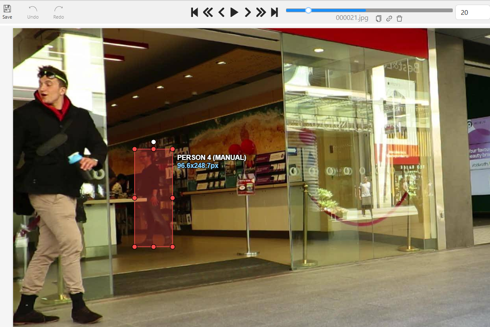
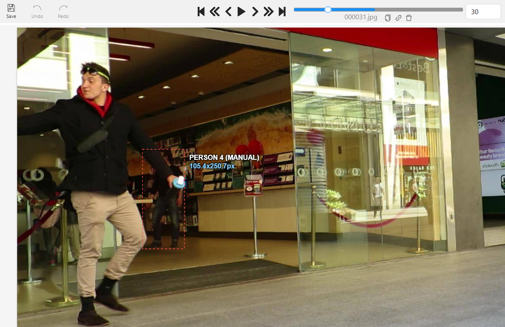
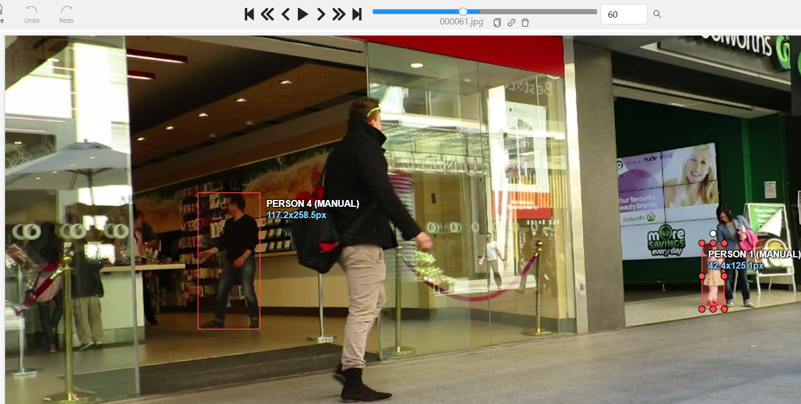
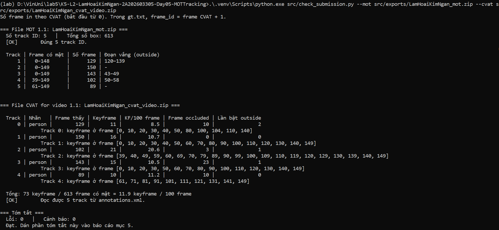

# Báo cáo cá nhân — Lâm Hoài Kim Ngân - 2A202603305

Đoạn video: MOT17-09, 150 frame (frame 1–150 / frame 0–149 trên CVAT), nguồn MOTChallenge, giấy phép CC BY-NC-SA 3.0.

## 0. Thông tin học viên

- Họ tên: Lâm Hoài Kim Ngân
- MSSV: 2A202603305
- Mã đề (A/B/C): A
- Email: lamhoaikimngan91@gmail.com
- Link repository: https://github.com/nganlam-vn/K5-L2-LamHoaiKimNgan-2A202603305-Day05-MOTTracking
- Giờ bắt đầu: 17:00
- Giờ kết thúc: 19:45

## 1. Xem trước đoạn video (CP0)

Ghi **trước khi vẽ**, mỗi người một dòng.

| Mã | Frame xuất hiện | Frame cuối thấy được | Rẽ / dừng / đổi tốc độ ở frame | Bị che ở frame | Ghi chú |
|---|---|---|---|---|---|
| P1 | 0 | 149 | 20–30 (chậm lại), 50 (bước ra), 100–110 (đổi hướng nhẹ sang phải) | 30–59 (che một phần ở 30–42 và 50–59, khuất hẳn ở 43–49) | -|
| P2 | 61 | 149 | Di chuyển đều, không đổi hướng đột ngột | 61–70 (bị khung kính / mép cửa shop che một phần khi mới xuất hiện) | -|
| P3 | 0 | 149 | 60–80 (bước đều, tịnh tiến dần lại gần camera) | Không bị che (0 frame occluded/outside) | Đi bộ dọc theo lề đường bên phải, kích thước box tăng dần khi lại gần camera |
| P4 | 39 | 149 | 49–60 (di chuyển dọc lề phải sát mép khung hình) | 39, 49, 59 (che một phần), 50–58 (khuất mép / ngoài khung hình) | Xuất hiện từ frame 39 ở mép phải màn hình, đi cùng phía với P3 |
| P5 | 0 | 148 | 100–110 (chậm lại do người khác cắt ngang) | 110–119 (che một phần), 120–139 (khuất hẳn sau người khác) | - |

## 2. Keyframe và thời gian (CP1, CP4)

Số keyframe lấy từ kết quả `src/check_submission.py`.

| Mã | Số keyframe | Keyframe ở frame | Số frame có mặt | Keyframe / 100 frame | Thời gian (phút) | Chỗ khó |
|---|---|---|---|---|---|---|
| P1 | 15 | 0, 10, 20, 30, 50, 60, 70, 80, 90, 100, 110, 120, 130, 140, 149 | 143 | 10.5 | 20 | Xử lý che khuất amodal khi bị người khác che (frame 30–59), căn mép chân qua kính phản chiếu |
| P2 | 10 | 61, 71, 81, 91, 101, 111, 121, 131, 141, 149 | 89 | 11.2 | 10 | Xuất hiện muộn ở frame 61, bị che một phần thân bởi khung cửa kính |
| P3 | 16 | 0, 10, 20, 30, 40, 50, 60, 70, 80, 90, 100, 110, 120, 130, 140, 149 | 150 | 10.7 | 15 | Đi lại gần camera khiến kích thước box tăng nhanh, cần chỉnh scale đều đặn để tránh trôi viền |
| P4 | 21 | 39, 40, 49, 50, 59, 60, 69, 70, 79, 89, 90, 99, 100, 109, 110, 119, 120, 129, 130, 139, 140, 149 | 102 | 20.6 | 18 | Xuất hiện sát mép khung hình, sải bước không đều, cần nhiều keyframe để giữ box khít người |
| P5 | 11 | 0, 10, 20, 30, 40, 50, 80, 100, 104, 110, 140 | 129 | 8.5 | 12 | Kích thước box nhỏ do ở xa, đoạn bị che khuất khá dài ở frame 120–139 |
| **Tổng** | **73** | — | **613** | **11.9** | **75** | — |

Keyframe / 100 frame của cả bài = tổng keyframe ÷ tổng số frame có mặt × 100 = 73 ÷ 613 × 100 = **11.9** keyframe / 100 frame.

Bạn đặt keyframe nhiều nhất ở người nào? Vì sao (người đó rẽ, dừng, lại gần camera hay bị che)?

- Em đặt nhiều keyframe nhất ở người **P4**.
- **Lý do:** Đối với P4, người này xuất hiện ở mép ngoài cùng bên phải khung hình từ frame 39, di chuyển lại gần camera với tốc độ bước chân không đều và có đoạn bị che khuất/khuất mép (frame 50). Do chuyển động bước đi và sự thay đổi phối cảnh góc rộng ở mép camera diễn ra nhanh, phép nội suy tuyến tính (Linear Interpolation) dễ bị trễ hoặc lệch IoU nếu khoảng cách keyframe quá thưa. Vì vậy, em phải cắm thêm keyframe ở các mốc ngắn (như 39, 40, 49, 50, 59, 60...) để đảm bảo bounding box bám khít sát toàn thân.

## 3. Đoạn bị che (CP2)

Người bị che: `P1`

| Mốc | Frame |
|---|---:|
| Bắt đầu bị che một phần (bật `occluded`) | 30 |
| Mất hẳn (bật `outside`) | 43 |
| Hiện lại (tắt `outside`) | 50 |
| Thấy rõ trở lại (tắt `occluded`) | 60 |

- Thời gian khuất hẳn: **7** frame = **0.23** giây (7 ÷ 30 fps ≈ 0.23s).
- Quyết định: **giữ cùng ID** (Track ID 3 trong MOT 1.1 / Track 3 trong CVAT).
- Lý do (trả lời 3 câu: khuất bao lâu so với 60 frame, ngoại hình có khớp, chỗ hiện lại có đúng hướng và tốc độ):
  1. *Khuất bao lâu so với ngưỡng 60 frame:* Thời gian khuất hẳn chỉ diễn ra trong 7 frame (~0.23 giây), ngắn hơn rất nhiều so với ngưỡng quy ước 60 frame (2 giây) của bài lab.
  2. *Ngoại hình có khớp không:* Người tái xuất hiện mặc áo len đen dài tay, quần tối màu, mang cùng vóc dáng, chiều cao và đặc điểm hình thể hoàn toàn trùng khớp với người trước khi bị che.
  3. *Chỗ hiện lại có đúng hướng và tốc độ không:* Vị trí xuất hiện lại tại frame 50 nằm ngay phía bên phải của người che khuất (Person 2), tiếp nối chính xác quỹ đạo chuyển động tịnh tiến từ trái sang phải với vận tốc bước đi đều đặn qua mặt tiền cửa hàng Vodafone.

Ảnh chụp màn hình:

## 4. Tự review ID (CP3)

Lượt 1 theo người (đi ngược từ frame 149 về 0 trên CVAT), lượt 2 theo cảnh (nhảy 10 frame). Ít nhất 3 dòng; không có lỗi thì ghi một dòng "đã kiểm hai lượt, không lỗi".

Loại lỗi dùng đúng một trong 7 mã: `id_switch`, `fragmentation`, `lost`, `merge`, `false_track`, `drift`, `flag`.

| Frame | Mã người | Loại lỗi | Mô tả một câu | Phát hiện ở lượt | Đã sửa? |
|---:|---|---|---|---|---|
| 30–42 | P1 | `flag` | Quên bật thuộc tính `occluded` khi P1 bắt đầu bị thân người P2 che khuất một phần | Lượt 1 (theo người) | Đã sửa (bật cờ `occluded` từ frame 30 đến 42) |
| 43–49 | P1 | `flag` | Vẫn để box ước lượng hiển thị khi P1 đã bị che lấp 100% thay vì bật `outside` | Lượt 1 (theo người) | Đã sửa (bật cờ `outside` từ frame 43 đến 49) |
| 75 | P3 | `drift` | Bounding box bị trôi tụt lại phía sau lưng người do người đi nhanh dần lại gần camera | Lượt 1 (theo người) | Đã sửa (thêm keyframe căn chỉnh lại mép hộp) |
| 50 | P4 | `lost` | Quên tắt cờ `outside` khiến đối tượng bị mất box hiển thị dù người đã bước lộ diện | Lượt 2 (theo cảnh) | Đã sửa (tắt `outside` tại frame 50 và chỉnh lại box) |

Tổng hợp số lỗi theo loại:

| `id_switch` | `fragmentation` | `lost` | `merge` | `false_track` | `drift` | `flag` |
|---:|---:|---:|---:|---:|---:|---:|
| 0 | 0 | 1 | 0 | 0 | 1 | 2 |

Lỗi nào chỉ lượt 2 (theo cảnh) mới thấy, lượt 1 (theo người) không thấy? Vì sao?

- **Lỗi chỉ lượt 2 mới thấy:** Lỗi `lost` của đối tượng P4 tại frame 50 và sự tương quan giữa các đối tượng trong cùng một không gian.
- **Giải thích:** Khi thực hiện lượt 1 (soát theo từng người), mắt người gán nhãn tập trung bám sát quỹ đạo cục bộ của một đối tượng cụ thể nên dễ bỏ quên bức tranh toàn cảnh. Đến lượt 2 (soát theo cảnh toàn cục, nhảy mỗi bước 10 frame), ta quan sát đồng thời cả 5 bounding box trên cùng một màn hình, do đó lập tức nhận ra sự bất thường khi số lượng bounding box giảm đột ngột từ 5 xuống 4 ở frame 50, phát hiện ngay đối tượng bị mất box (`lost`) mà lượt 1 dễ bỏ sót.

## 5. File xuất và kết quả tự kiểm (CP4)

| Kiểm tra | Kết quả |
|---|---|
| Tên file MOT 1.1 | `LamHoaiKimNgan_mot.zip` |
| Tên file CVAT for video 1.1 | `LamHoaiKimNgan_cvat_video.zip` |
| Số track ID khác nhau trong `gt/gt.txt` (phải là 5) | 5 track ID |
| Frame `outside` không có dòng trong `gt.txt` (đúng / sai) | Đúng |
| Job đã completed trên CVAT máy cá nhân | Đã completed |

Dán phần tóm tắt in ra từ `src/check_submission.py`:

  Số track ID: 5   |   Tổng số box: 613
  [OK]        Đúng 5 track ID.

1. Nếu được gán lại, bạn sẽ đặt keyframe khác ở đâu? Vì sao?

2. Có chỗ nào bạn không chắc "cùng ID hay ID mới"? Bạn đã quyết định và ghi chú thế nào?
Không có, vì đã hỏi lab coach và đã được hướng dẫn
## 6. Ba câu kết

1. **Nếu được gán lại, bạn sẽ đặt keyframe khác ở đâu? Vì sao?**
   - Ở đối tượng **P5**, em sẽ bổ sung thêm 1 keyframe trung gian tại frame 102 để định hình box tốt hơn ngay trước khi đối tượng bước vào vùng bị người khác che khuất ở frame 110.

2. **Có chỗ nào bạn không chắc "cùng ID hay ID mới"? Bạn đã quyết định và ghi chú thế nào?**
   Không có 
3. **Một lỗi ID trong job của bạn (nếu không còn sót, chọn lỗi đã sửa) có thể làm xe tự lái dự đoán sai chuyển động của người đó như thế nào? Lỗi đó ảnh hưởng MOTA hay IDF1 nhiều hơn?**
   

## Bonus (nếu làm)

### B1 — Hai người đi sát

*(Không thực hiện trong bài nộp chính)*

### B2 — So cách đặt keyframe

*(Không thực hiện trong bài nộp chính)*

### B3 — So với tracker có sẵn

*(Không thực hiện trong bài nộp chính)*

## 7. Tài liệu tham khảo và công cụ AI đã dùng

